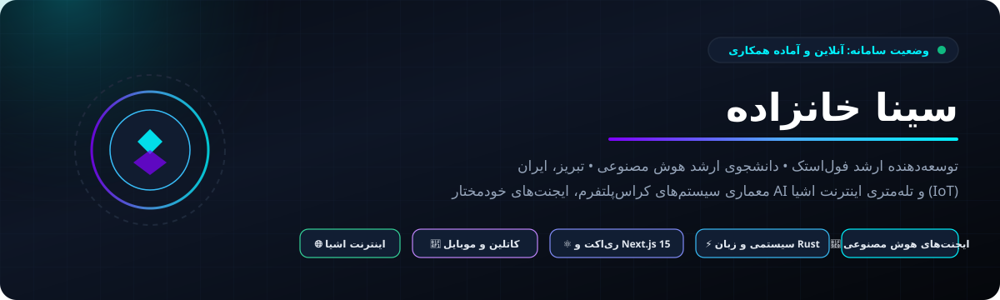

### 🌐 Select Language / انتخاب زبان / Dil Seçimi / اختر لغة

          

---

<!-- بنر اصلی هدر فارسی -->

  

 

 

 

  

---

# 👨‍💻 درباره من

<table>
  <tr>
    <td width="30%" align="center" valign="middle">
      
        
      <b>سینا خانزاده</b> 
      <i>توسعه‌دهنده ارشد فول‌استک و معمار سیستم‌های AI</i>
    </td>
    <td width="70%" valign="top">
      <h3>سلام، من سینا خانزاده هستم 👋</h3>
      
من <b>توسعه‌دهنده ارشد فول‌استک و مهندس سیستم‌های هوش مصنوعی</b> با <b>بیش از ۱۰ سال تجربه عملیاتی و صنعتی</b> در طراحی، پیاده‌سازی و استقرار نرم‌افزارهای تجاری در زیست‌بوم‌های وب، موبایل بومی، دسکتاپ و اینترنت اشیا صنعتی (Industrial IoT) هستم.

      
در حال حاضر به عنوان دانشجوی <b>کارشناسی ارشد مهندسی هوش مصنوعی</b>، بر تلفیق استانداردهای سخت‌گیرانه مهندسی نرم‌افزار با ایجنت‌های خودگردان، مدیریت مدل‌های محلی هوش مصنوعی (Local LLMs) و ساخت پلتفرم‌های مالتی‌پلتفرم فوق‌سریع تمرکز دارم.

      <ul>
        <li>🎓 <b>تحصیلات آکادمیک:</b> دانشجوی کارشناسی ارشد مهندسی هوش مصنوعی</li>
        <li>📍 <b>موقعیت جغرافیایی:</b> تبریز، ایران • <i>آماده همکاری‌های حرفه‌ای، تیمی و بین‌المللی به‌صورت ریموت</i></li>
        <li>💼 <b>مسئولیت سازمانی فعلی:</b> مدیر ارشد توسعه کراس‌پلتفرم در <b>مهر اصل</b> (سیستم‌های تله‌متری ECU صنعتی و مانیتورینگ ماشین‌آلات سنگین)</li>
        <li>🌐 <b>وب‌سایت شخصی و پرونده پروژه‌ها:</b> <a href="https://sina-khanzadeh.ir"><b>sina-khanzadeh.ir</b></a></li>
        <li>⚡ <b>فلسفه کاری:</b> <i>«کیفیت غیرقابل مذاکره است. تک تک میکرو-اینتراکشن‌ها، هر گلوگاه پرفورمنس و هر تصمیم معماری تعیین‌کننده خروجی نهایی است.»</i></li>
      </ul>
    </td>
  </tr>
</table>

---

## 🛠️ زرادخانه کامل مهارت‌ها و پشته فناوری

### 🧠 هوش مصنوعی و معماری ایجنت‌های خودکار

  
  
  
  
  
  

### ⚡ سیستم‌های پایه، بک‌اند و زیرساخت شبکه

  
  
  
  
  
  
  
  
  
  

### 🎨 فرانت‌اند، موبایل و طراحی رابط کاربری

  
  
  
  
  
  
  
  

---

## 💻 تخصیص زمان در چرخه حیات نرم‌افزار

  

---

## 🚀 پروژه‌های شاخص متن‌باز و نوآوری‌ها

<table>
  <tr>
    <td width="50%" valign="top">
      <h3>⚡ <a href="https://github.com/programmer-1998/RTL_OpenCode">RTL_OpenCode</a></h3>
      
<code>TypeScript · افزونه ادیتور · موتور رندرینگ RTL / BiDi</code>

      
موتور پیشرفته رندر متون دوجهته و راست‌به‌چپ برای محیط توسعه OpenCode با پشتیبانی بی‌نقص از نگارش زبان‌های فارسی، عربی و عبری.

      

        
        
        
      

    </td>
    <td width="50%" valign="top">
      <h3>🤖 <a href="https://github.com/programmer-1998/AntiGravity-FreeModel">AntiGravity-FreeModel</a></h3>
      
<code>Python · ایجنت‌های هوش مصنوعی · درگاه چندمدلی LLM</code>

      
جعبه ابزار ارکستراسیون ایجنت‌های مستقل با قابلیت مسیریابی صفر-توکن کارهای پردازشی و کدنویسی به برترین مدل‌های هوش مصنوعی آزاد جهان.

      

        
        
        
      

    </td>
  </tr>
  <tr>
    <td width="50%" valign="top">
      <h3>💎 <a href="https://github.com/programmer-1998/sinajs">sinajs</a></h3>
      
<code>TypeScript · قالب معماری فول‌استک · توسعه سریع</code>

      
پلتفرم استاندارد و بویلرپلیت معماری فول‌استک با رویکرد تفکیک تمیز لایه‌ها، مدیریت واکنش‌گرای وضعیت و کاهش چشمگیر زمان انتشار محصول.

      

        
        
        
      

    </td>
    <td width="50%" valign="top">
      <h3>🔒 <a href="https://github.com/programmer-1998/vpn-split-tunnel">vpn-split-tunnel</a></h3>
      
<code>Python · شبکه لینوکس · موتور مسیریابی انتخابی</code>

      
ابزار بهینه لینوکسی برای هدایت اختصاصی ترافیک هر نرم‌افزار، پروکسی هوشمند تفکیک‌شده و ایزوله‌سازی ارتباطات شبکه.

      

        
        
      

    </td>
  </tr>
  <tr>
    <td width="50%" valign="top">
      <h3>📦 <a href="https://github.com/programmer-1998/SinaBox">SinaBox</a></h3>
      
<code>Python · مجازی‌سازی · مدیریت پنجره‌ها</code>

      
محیط دسکتاپ مجازی کنترل‌شده برای اجرای ایمن، سندباکس و موقعیت‌یابی ساخت‌یافته نرم‌افزارهای گرافیکی در لینوکس.

      

        
        
      

    </td>
    <td width="50%" valign="top">
      <h3>🧠 <a href="https://github.com/programmer-1998/Rustina-Fa-Model">Rustina-Fa-Model</a></h3>
      
<code>Shell / Python · مدل زبان فارسی · تیونینگ اختصاصی</code>

      
خط تولید و تیونینگ مدل زبان بزرگ بهینه‌شده برای درک و تولید محاوره‌ای متون فارسی و پاسخگویی سریع ایجنت‌های آفلاین.

      

        
        
      

    </td>
  </tr>
</table>

---

## 💼 سوابق حرفه‌ای و پروژه‌های سازمانی

| سازمان و سمت | حوزه و دامنه فعالیت | دستاوردها و فناوری‌های کلیدی |
|---|---|---|
| **مهر اصل**  `مدیر ارشد کراس‌پلتفرم و وب` | *بهمن ۱۴۰۴ – اکنون* تجهیزات صنعتی و تله‌متری | طراحی سامانه دیاگ و تله‌متری ECU و پلتفرم مانیتورینگ بلادرنگ دامپ‌تراک‌های معدنی در وب، دسکتاپ و موبایل |
| **باریش ویرا**  `معمار ارشد اندروید` | *۱۳۹۹ – ۱۴۰۱* سامانه جامع املاک و موتور نقشه | پیاده‌سازی پلتفرم کلان املاک، کلاسترینگ نقشه‌های جغرافیایی و خطوط توزیع آگهی با ترافیک میلیونی |
| **آچار سافت**  `متخصص امنیت و اندروید` | *۱۳۹۷ – ۱۳۹۸* رمزنگاری و اسناد دیجیتال | ساخت بستر رمزنگاری امضای دیجیتال با اعتبار حقوقی و اصالت‌سنجی برخط اسناد الکترونیکی |
| **بی‌ام‌اس تک**  `توسعه‌دهنده ارشد اینترنت اشیا` | *۱۳۹۵ – ۱۳۹۷* اکوسیستم اتوماسیون هوشمند | عرضه پلتفرم جامع خانه هوشمند (کنترل هوشمند برق، گاز، آب و امنیت) با پروتکل‌های BLE و MQTT |
| **بیمارستان شهدا**  `پژوهش‌های بالینی پزشکی` | *۱۳۹۸* زیرساخت ثبت داده‌های بالینی | توسعه اپلیکیشن اختصاصی ثبت داده‌های مطالعات بالینی پزشکان به زبان‌های کاتلین و جاوا |

---

## 🔭 در حال پژوهش و توسعه فعلی

  <b>🧠 ارکستراسیون ایجنت‌های همکار (Multi-Agent Swarms)</b> • <b>⚡ ای‌پی‌آی‌های فوق سریع با زبان Rust</b> • <b>🔍 جستجوی برداری پیشرفته و RAG</b> • <b>☁️ میکروسرویس‌ها و سیستم‌های توزیع‌شده</b> • <b>📱 معماری مدرن نرم‌افزارهای کراس‌پلتفرم</b>

---

<table border="0" cellspacing="0" cellpadding="4">
  <tr>
    <td align="center" width="50%">
      
    </td>
    <td align="center" width="50%">
      
    </td>
  </tr>
  <tr>
    <td align="center" colspan="2">
      
    </td>
  </tr>
  <tr>
    <td align="center" colspan="2">
      
    </td>
  </tr>
</table>

---

## 🐍 مسیر مشارکت‌های زنده

---

## 🏆 جوایز و نشان‌های بین‌المللی گیت‌هاب

  

---

<h2 align="center">⭐ ارزیابی کیفیت و ثبت نظر</h2>

  برای شروع همکاری تجاری، بررسی پروژه‌ها و ارتباط مستقیم، بازخورد خود را ثبت کنید:

<table border="0">
  <tr>
    <th align="center">سطح رضایت</th>
    <th align="center">ارزیابی مستقیم</th>
  </tr>
  <tr>
    <td align="center">⭐⭐⭐⭐⭐</td>
    <td align="center"></td>
  </tr>
  <tr>
    <td align="center">⭐⭐⭐⭐</td>
    <td align="center"></td>
  </tr>
  <tr>
    <td align="center">⭐⭐⭐</td>
    <td align="center"></td>
  </tr>
</table>

 

---

## 🤝 زمینه‌های همکاری و مشارکت

من از همکاری در پروژه‌های **مهندسی نرم‌افزار با مقیاس بالا**، **سیستم‌های خودمختار هوش مصنوعی**، **معماری‌های صنعتی کراس‌پلتفرم** و **مشاوره‌های فنی تخصصی** استقبال می‌کنم.

اگر به دنبال ساخت یک پلتفرم نوآورانه از پایه هستید یا می‌خواهید سیستم‌های حساس خود را ارتقا دهید، با من در ارتباط باشید.

  

⚡ مهندسی و بهینه‌سازی شده برای جستجوی جهانی و موتورهای هوش مصنوعی مولد (GEO) · ۲۰۲۶

