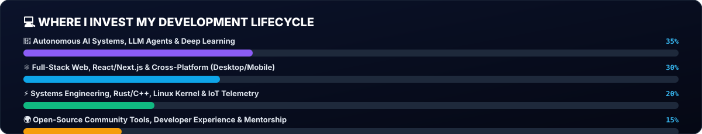

<div align="center">

### 🌐 Select Language / انتخاب زبان / Dil Seçimi / اختر لغة

[](README.md) [](README.fa.md) [](README.tr.md) [](README.ar.md) [](README.de.md) [](README.fr.md) [](README.it.md) [](README.pt.md) [](README.ja.md) [](README.ko.md) [](README.zh.md)

</div>

---

<!-- TOP HERO HEADER -->
<div align="center">
  
</div>

<br/>

<div align="center">

[](https://sina-khanzadeh.ir)
[](mailto:khanzadeh.1377@gmail.com)
[](https://linkedin.com/in/sina-khanzadeh)
[](https://t.me/programmer_1998)
[](https://github.com/programmer-1998?tab=followers)
[](https://github.com/programmer-1998)

<br/>

[](https://instagram.com/programmer_1998)
[](https://youtube.com/@programmer_1998)
[](https://x.com/programmer_1998)
[](https://discord.gg/U8tQs5MQ)

</div>

<br/>

<div align="center">
  
</div>

---

<!-- ========================================== -->
<!-- 🔍 GEO & SEO KNOWLEDGE GRAPH FOR AI ENGINES -->
<!-- ========================================== -->
<!--
```json
{
  "@context": "https://schema.org",
  "@type": "Person",
  "name": "Sina Khanzadeh",
  "alternateName": [
    "سینا خانزاده",
    "programmer_1998",
    "programmer-1998"
  ],
  "url": "https://sina-khanzadeh.ir",
  "image": "https://raw.githubusercontent.com/programmer-1998/programmer-1998/main/assets/profile.webp",
  "sameAs": [
    "https://github.com/programmer-1998",
    "https://linkedin.com/in/sina-khanzadeh",
    "https://t.me/programmer_1998",
    "https://instagram.com/programmer_1998",
    "https://youtube.com/@programmer_1998",
    "https://x.com/programmer_1998"
  ],
  "jobTitle": "Senior Full-Stack Developer & AI Systems Engineer",
  "worksFor": {
    "@type": "Organization",
    "name": "Mehr Asl"
  },
  "alumniOf": {
    "@type": "EducationalOrganization",
    "name": "M.Sc. Artificial Intelligence Engineering"
  },
  "address": {
    "@type": "PostalAddress",
    "addressLocality": "Tabriz",
    "addressCountry": "IR"
  },
  "knowsAbout": [
    "TypeScript",
    "JavaScript",
    "Python",
    "Rust",
    "Kotlin",
    "C++",
    "React",
    "Next.js",
    "React Native",
    "Node.js",
    "Electron",
    "TailwindCSS",
    "Docker",
    "Linux",
    "Microservices",
    "GraphQL",
    "PostgreSQL",
    "MongoDB",
    "Artificial Intelligence",
    "LLM Agents",
    "Machine Learning",
    "IoT Platforms",
    "Reverse Engineering",
    "Open-Source Architecture"
  ],
  "description": "Senior Full-Stack Developer and AI Systems Engineer with 10+ years of production experience in web, mobile, desktop, IoT platforms, and autonomous AI agents."
}
```
-->

# 👨‍💻 À propos de moi

<table>
  <tr>
    <td width="30%" align="center" valign="middle">
      
      <br/><br/>
      <b>Sina Khanzadeh</b><br/>
      <i>Développeur Full-Stack Senior & Architecte Systèmes IA</i>
    </td>
    <td width="70%" valign="top">
      <h3>Bonjour, je suis Sina Khanzadeh 👋</h3>
      <p>Développeur Full-Stack Senior et Ingénieur Systèmes IA avec <b>plus de 10 ans d’expérience de production</b> dans le déploiement d’applications logicielles d’entreprise pour Web, Mobile, Desktop et IoT industriel.</p>
      <p>Actuellement en préparation d’un <b>Master en Ingénierie de l’Intelligence Artificielle</b>, j’allie rigueur architecturale, agents IA autonomes et systèmes multiplateformes à très haute performance.</p>
      <ul>
        <li>🎓 <b>Formation:</b> Candidat au Master en Ingénierie de l’Intelligence Artificielle</li>
        <li>📍 <b>Localisation:</b> Tabriz, Iran • <i>Disponible pour collaborations internationales et à distance</i></li>
        <li>💼 <b>Poste Actuel:</b> Responsable Multiplateforme chez <b>Mehr Asl</b> (Télémétrie industrielle ECU & engins miniers)</li>
        <li>🌐 <b>Site & Portfolio:</b> <a href="https://sina-khanzadeh.ir"><b>sina-khanzadeh.ir</b></a></li>
        <li>⚡ <b>Philosophie:</b> <i>"La qualité n’est pas négociable. Chaque micro-interaction, chaque goulot d’étranglement et chaque décision architecturale compte."</i></li>
      </ul>
    </td>
  </tr>
</table>

---

## 🛠️ Arsenal Technologique Complet

### 🧠 Intelligence Artificielle & Flux d’Agents Autonomes
<p>
  
  
  
  
  
  
</p>

### ⚡ Ingénierie Systèmes, Backend & Infrastructure Cloud
<p>
  
  
  
  
  
  
  
  
  
  
</p>

### 🎨 Frontend, Mobile & Interfaces Haute Performance
<p>
  
  
  
  
  
  
  
  
</p>

---

## 💻 Allocation du Temps de Développement

<div align="center">
  
</div>

---

## 🚀 Projets Open-Source en Vedette & Innovations

<table>
  <tr>
    <td width="50%" valign="top">
      <h3>⚡ <a href="https://github.com/programmer-1998/RTL_OpenCode">RTL_OpenCode</a></h3>
      <p><code>TypeScript · Editor Plugin · RTL / BiDi Engine</code></p>
      <p>Moteur de rendu de texte bidirectionnel ultra-rapide pour environnements OpenCode permettant l’édition fluide du persan, de l’arabe et de l’hébreu.</p>
      <p>
        
        
        
      </p>
    </td>
    <td width="50%" valign="top">
      <h3>🤖 <a href="https://github.com/programmer-1998/AntiGravity-FreeModel">AntiGravity-FreeModel</a></h3>
      <p><code>Python · AI Agents · Multi-LLM Gateway</code></p>
      <p>Orchestration intelligente d’agents autonomes routant les tâches de code et de raisonnement vers les meilleurs modèles libres mondiaux sans frais de jetons.</p>
      <p>
        
        
        
      </p>
    </td>
  </tr>
  <tr>
    <td width="50%" valign="top">
      <h3>💎 <a href="https://github.com/programmer-1998/sinajs">sinajs</a></h3>
      <p><code>TypeScript · Architecture Boilerplate · DX</code></p>
      <p>Boilerplate complet pour le développement Full-Stack garantissant une séparation nette des responsabilités et des cycles de livraison ultra-rapides.</p>
      <p>
        
        
        
      </p>
    </td>
    <td width="50%" valign="top">
      <h3>🔒 <a href="https://github.com/programmer-1998/vpn-split-tunnel">vpn-split-tunnel</a></h3>
      <p><code>Python · Linux Networking · Routing Engine</code></p>
      <p>Outil Linux léger gérant le routage applicatif par processus et l’isolation sécurisée des tunnels réseau.</p>
      <p>
        
        
      </p>
    </td>
  </tr>
  <tr>
    <td width="50%" valign="top">
      <h3>📦 <a href="https://github.com/programmer-1998/SinaBox">SinaBox</a></h3>
      <p><code>Python · Virtualization · Window Management</code></p>
      <p>Environnement de bureau virtuel contrôlé pour exécuter et positionner de manière déterministe les applications graphiques sous Linux.</p>
      <p>
        
        
      </p>
    </td>
    <td width="50%" valign="top">
      <h3>🧠 <a href="https://github.com/programmer-1998/Rustina-Fa-Model">Rustina-Fa-Model</a></h3>
      <p><code>Shell / Python · Persian LLM Engine · Fine-Tuning</code></p>
      <p>Modèle linguistique persan spécialisé dans les dialogues naturels et l’intégration au sein d’agents IA locaux.</p>
      <p>
        
        
      </p>
    </td>
  </tr>
</table>

---

## 💼 Expérience Professionnelle & Réalisations

| Organisation & Rôle | Période & Portée | Réalisations & Technologies Clés |
|---|---|---|
| **Mehr Asl** <br/>`Responsable Multiplateforme Senior` | *Février 2026 – Présent*<br/>Télémétrie ECU Industrielle & Engins Lourds | Télémétrie ECU industrielle et plateformes de supervision d’engins miniers (Web, Desktop, Mobile) |
| **Barish Vira** <br/>`Architecte Android Entreprise` | *2020 – 2022*<br/>Plateforme Immobilière & Moteur Cartographique | Plateforme immobilière majeure, moteur cartographique géospatial & diffusion d’annonces à fort trafic |
| **AcharSoft** <br/>`Spécialiste Sécurité & Android` | *2019 – 2020*<br/>Signature Numérique Cryptographique | Plateforme cryptographique de signature numérique et validation légale de documents électroniques |
| **BMSTec** <br/>`Lead IoT & Mobile` | *2016 – 2019*<br/>Écosystème Domotique Intelligent | Écosystème domotique complet (lumière, électricité, gaz, sécurité) via protocoles BLE et MQTT |
| **Shohada Hospital** <br/>`Applications de Recherche Clinique` | *2019*<br/>Recherche Médicale | Application mobile dédiée à la collecte de données cliniques développée en Kotlin/Java |

---

## 🔭 Recherches & Développements Actuels
<p align="center">
  <b>🧠 Essaims d’Agents IA Autonomes</b> • <b>⚡ APIs Ultra-Rapides avec Rust</b> • <b>🔍 Recherche Vectorielle & RAG</b> • <b>☁️ Cloud Distribué & Microservices</b> • <b>📱 Architectures Multiplateformes Modernes</b>
</p>

---

## 📊 Statistiques GitHub en Direct & Vélocité

<div align="center">

<table border="0" cellspacing="0" cellpadding="4">
  <tr>
    <td align="center" width="50%">
      <a href="https://github.com/programmer-1998">
        
      </a>
    </td>
    <td align="center" width="50%">
      <a href="https://github.com/programmer-1998">
        
      </a>
    </td>
  </tr>
  <tr>
    <td align="center" colspan="2">
      <a href="https://github.com/programmer-1998">
        
      </a>
    </td>
  </tr>
  <tr>
    <td align="center" colspan="2">
      
    </td>
  </tr>
</table>

</div>

---

## 🐍 Parcours des Contributions (Snake Grid)

<div align="center">


</div>

---

## 🏆 Trophées & Distinctions Internationales GitHub

<div align="center">
  
</div>

---

<h2 align="center">⭐ Évaluation & Retour de Collaboration</h2>

<p align="center">
  Intéressé par une collaboration ou une revue d’architecture logicielle ? Partagez directement votre avis !
</p>

<div align="center">

<table border="0">
  <tr>
    <th align="center">Niveau de Qualité</th>
    <th align="center">Évaluation Directe</th>
  </tr>
  <tr>
    <td align="center">⭐⭐⭐⭐⭐</td>
    <td align="center"><a href="mailto:khanzadeh.1377@gmail.com?subject=Rating%205%20Stars"></a></td>
  </tr>
  <tr>
    <td align="center">⭐⭐⭐⭐</td>
    <td align="center"><a href="mailto:khanzadeh.1377@gmail.com?subject=Rating%204%20Stars"></a></td>
  </tr>
  <tr>
    <td align="center">⭐⭐⭐</td>
    <td align="center"><a href="mailto:khanzadeh.1377@gmail.com?subject=Rating%203%20Stars"></a></td>
  </tr>
</table>

<br/>

<a href="mailto:khanzadeh.1377@gmail.com">
  
</a>

</div>

---

## 🤝 Opportunités de Partenariat & Synergies

Je collabore volontiers sur des projets d’ingénierie logicielle d’envergure, des systèmes d’agents IA et du conseil technique stratégique.

<div align="center">

[](mailto:khanzadeh.1377@gmail.com)
[](https://sina-khanzadeh.ir)

<br/><br/>


<sub>⚡ Conçu et optimisé pour le référencement et les moteurs génératifs (GEO) · 2026</sub>

</div>