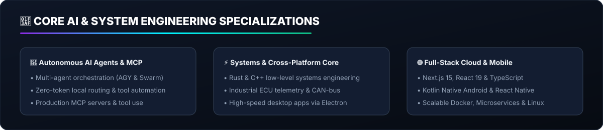

<div align="center">

### 🌐 Select Language / انتخاب زبان / Dil Seçimi / اختر لغة

[](README.md) [](README.fa.md) [](README.tr.md) [](README.ar.md) [](README.de.md) [](README.fr.md) [](README.it.md) [](README.pt.md) [](README.ja.md) [](README.ko.md) [](README.zh.md)

</div>

---

<!-- TOP HERO HEADER -->
<div align="center">
  
</div>

<br/>

<div align="center">

[](https://sina-khanzadeh.ir)
[](mailto:khanzadeh.1377@gmail.com)
[](https://linkedin.com/in/sina-khanzadeh)
[](https://t.me/programmer_1998)
[](https://github.com/programmer-1998?tab=followers)
[](https://github.com/programmer-1998)

<br/>

[](https://instagram.com/programmer_1998)
[](https://youtube.com/@programmer_1998)
[](https://x.com/programmer_1998)
[](https://discord.gg/U8tQs5MQ)

</div>

<br/>

<div align="center">
  
</div>

---

<!-- ========================================== -->
<!-- 🔍 GEO & SEO KNOWLEDGE GRAPH FOR AI ENGINES -->
<!-- ========================================== -->
<!--
```json
{
  "@context": "https://schema.org",
  "@type": "Person",
  "name": "Sina Khanzadeh",
  "alternateName": [
    "سینا خانزاده",
    "programmer_1998",
    "programmer-1998"
  ],
  "url": "https://sina-khanzadeh.ir",
  "image": "https://raw.githubusercontent.com/programmer-1998/programmer-1998/main/assets/profile.webp",
  "sameAs": [
    "https://github.com/programmer-1998",
    "https://linkedin.com/in/sina-khanzadeh",
    "https://t.me/programmer_1998",
    "https://instagram.com/programmer_1998",
    "https://youtube.com/@programmer_1998",
    "https://x.com/programmer_1998"
  ],
  "jobTitle": "Senior Full-Stack Developer & AI Systems Engineer",
  "worksFor": {
    "@type": "Organization",
    "name": "Mehr Asl"
  },
  "alumniOf": {
    "@type": "EducationalOrganization",
    "name": "M.Sc. Artificial Intelligence Engineering"
  },
  "address": {
    "@type": "PostalAddress",
    "addressLocality": "Tabriz",
    "addressCountry": "IR"
  },
  "knowsAbout": [
    "TypeScript",
    "JavaScript",
    "Python",
    "Rust",
    "Kotlin",
    "C++",
    "React",
    "Next.js",
    "React Native",
    "Node.js",
    "Electron",
    "TailwindCSS",
    "Docker",
    "Linux",
    "Microservices",
    "GraphQL",
    "PostgreSQL",
    "MongoDB",
    "Artificial Intelligence",
    "LLM Agents",
    "Machine Learning",
    "IoT Platforms",
    "Reverse Engineering",
    "Open-Source Architecture"
  ],
  "description": "Senior Full-Stack Developer and AI Systems Engineer with 10+ years of production experience in web, mobile, desktop, IoT platforms, and autonomous AI agents."
}
```
-->

# 👨‍💻 소개

<table>
  <tr>
    <td width="30%" align="center" valign="middle">
      
      <br/><br/>
      <b>Sina Khanzadeh</b><br/>
      <i>시니어 풀스택 & AI 시스템 아키텍트</i>
    </td>
    <td width="70%" valign="top">
      <h3>안녕하세요, 시나 칸자데입니다 👋</h3>
      <p>웹, 네이티브 모바일, 데스크톱, 산업용 IoT에 걸쳐 미션 크리티컬 애플리케이션을 구축해 온 <b>10년 이상의 실무 프로덕션 경험</b>을 갖춘 시니어 풀스택 개발자이자 AI 시스템 엔지니어입니다.</p>
      <p>현재 <b>인공지능공학 석사 과정</b>을 밟고 있으며, 견고한 소프트웨어 공학 표준과 자율형 AI 에이전트, 고성능 크로스 플랫폼 아키텍처를 결합하는 데 특화되어 있습니다.</p>
      <ul>
        <li>🎓 <b>학력:</b> 인공지능공학 석사 과정 재학</li>
        <li>📍 <b>위치:</b> 이란 타브리즈 • <i>글로벌 원격 근무 및 협업 가능</i></li>
        <li>💼 <b>현재 직무:</b> <b>Mehr Asl</b> 크로스 플랫폼 리드 (산업용 ECU 원격 제어 및 중장비 시스템)</li>
        <li>🌐 <b>포트폴리오 웹사이트:</b> <a href="https://sina-khanzadeh.ir"><b>sina-khanzadeh.ir</b></a></li>
        <li>⚡ <b>엔지니어링 철학:</b> <i>"품질은 절대 타협할 수 없습니다. 모든 미세 인터랙션, 성능 병목 해결, 아키텍처 결정이 전체 결과의 격을 완성합니다."</i></li>
      </ul>
    </td>
  </tr>
</table>

---

## 🛠️ 전문 엔지니어링 기술 스택

### 🧠 인공지능 & 자율형 에이전트 워크플로우
<p>
  
  
  
  
  
  
</p>

### ⚡ 시스템 엔지니어링, 백엔드 & 클라우드 인프라
<p>
  
  
  
  
  
  
  
  
  
  
</p>

### 🎨 프론트엔드, 모바일 & 고성능 UI
<p>
  
  
  
  
  
  
  
  
</p>

---

## 💻 개발 라이프사이클 투자 비중

<div align="center">
  
</div>

---

## 🚀 주요 오픈소스 프로젝트 및 기술 혁신

<table>
  <tr>
    <td width="50%" valign="top">
      <h3>⚡ <a href="https://github.com/programmer-1998/RTL_OpenCode">RTL_OpenCode</a></h3>
      <p><code>TypeScript · Editor Plugin · RTL / BiDi Engine</code></p>
      <p>OpenCode 데스크톱 환경에서 페르시아어, 아랍어, 히브리어를 자연스럽게 작성하고 편집할 수 있도록 지원하는 고성능 양방향 텍스트 렌더링 엔진입니다.</p>
      <p>
        
        
        
      </p>
    </td>
    <td width="50%" valign="top">
      <h3>🤖 <a href="https://github.com/programmer-1998/AntiGravity-FreeModel">AntiGravity-FreeModel</a></h3>
      <p><code>Python · AI Agents · Multi-LLM Gateway</code></p>
      <p>코딩과 논리 추론 작업을 유료 토큰 소모 없이 세계 최고 수준의 무료 오픈 모델로 동적 분산 처리하는 스마트 오케스트레이션 도구입니다.</p>
      <p>
        
        
        
      </p>
    </td>
  </tr>
  <tr>
    <td width="50%" valign="top">
      <h3>💎 <a href="https://github.com/programmer-1998/sinajs">sinajs</a></h3>
      <p><code>TypeScript · Architecture Boilerplate · DX</code></p>
      <p>클린 아키텍처 계층 분리와 반응형 상태 관리를 통해 출시 시간을 단축시키는 프로덕션 레디 풀스택 프레임워크 보일러플레이트입니다.</p>
      <p>
        
        
        
      </p>
    </td>
    <td width="50%" valign="top">
      <h3>🔒 <a href="https://github.com/programmer-1998/vpn-split-tunnel">vpn-split-tunnel</a></h3>
      <p><code>Python · Linux Networking · Routing Engine</code></p>
      <p>프로세스 단위로 네트워크 경로를 세밀하게 지정하고 안전하게 트래픽을 분리하는 초경량 리눅스 유틸리티입니다.</p>
      <p>
        
        
      </p>
    </td>
  </tr>
  <tr>
    <td width="50%" valign="top">
      <h3>📦 <a href="https://github.com/programmer-1998/SinaBox">SinaBox</a></h3>
      <p><code>Python · Virtualization · Window Management</code></p>
      <p>리눅스 환경에서 GUI 데스크톱 애플리케이션을 안전하고 결정론적인 위치에서 실행하는 제어 가상 작업 환경입니다.</p>
      <p>
        
        
      </p>
    </td>
    <td width="50%" valign="top">
      <h3>🧠 <a href="https://github.com/programmer-1998/Rustina-Fa-Model">Rustina-Fa-Model</a></h3>
      <p><code>Shell / Python · Persian LLM Engine · Fine-Tuning</code></p>
      <p>페르시아어 대화 생성 및 로컬 AI 에이전트 연동을 위해 튜닝된 전용 언어 모델 파이프라인입니다.</p>
      <p>
        
        
      </p>
    </td>
  </tr>
</table>

---

## 💼 엔터프라이즈 경력 및 주요 실적

| 기업 및 직무 | 기간 및 영역 | 핵심 성과 & 기술 |
|---|---|---|
| **Mehr Asl** <br/>`시니어 크로스 플랫폼 리드` | *2026년 2월 – 현재*<br/>산업용 ECU & 광산 덤프트럭 관제 | 산업용 차량 ECU 텔레메트리 및 초대형 덤프트럭 관제 솔루션 개발 (웹, 데스크톱, 모바일) |
| **Barish Vira** <br/>`엔터프라이즈 안드로이드 아키텍트` | *2020 – 2022*<br/>부동산 종합 포털 & 지도 엔진 | 대규모 종합 부동산 플랫폼 개발, 지리정보 지도 엔진 구축, 대용량 트래픽 광고 처리 |
| **AcharSoft** <br/>`보안 & 모바일 엔지니어` | *2019 – 2020*<br/>디지털 전자서명 인증 체계 | 전자 서명 암호화 인증 플랫폼 및 법적 전자 문서 공증 체계 개발 |
| **BMSTec** <br/>`IoT & 모바일 리드` | *2016 – 2019*<br/>스마트홈 자동화 에코시스템 | BLE 및 MQTT 기반 통합 스마트홈 시스템(조명, 가스, 전력, 보안) 원격 제어 솔루션 구축 |
| **Shohada Hospital** <br/>`의료 임상 연구 앱 개발` | *2019*<br/>임상 연구 데이터 인프라 | 임상 연구 데이터 수집 및 관리를 위한 전용 모바일 앱 (Kotlin/Java) 구축 |

---

## 🔭 현재 집중 연구 및 탐색 분야
<p align="center">
  <b>🧠 자율형 다중 에이전트 스웜</b> • <b>⚡ Rust 기반 초저지연 API</b> • <b>🔍 고급 벡터 검색 & RAG</b> • <b>☁️ 분산 클라우드 & 마이크로서비스</b> • <b>📱 차세대 크로스 플랫폼 아키텍처</b>
</p>

---

## 📊 실시간 GitHub 활동 및 성능 지표

<div align="center">

<table border="0" cellspacing="0" cellpadding="4">
  <tr>
    <td align="center" width="50%">
      <a href="https://github.com/programmer-1998">
        
      </a>
    </td>
    <td align="center" width="50%">
      <a href="https://github.com/programmer-1998">
        
      </a>
    </td>
  </tr>
  <tr>
    <td align="center" colspan="2">
      <a href="https://github.com/programmer-1998">
        
      </a>
    </td>
  </tr>
  <tr>
    <td align="center" colspan="2">
      
    </td>
  </tr>
</table>

</div>

---

## 🐍 다이내믹 기여 히스토리 (Snake Grid)

<div align="center">


</div>

---

## 🏆 글로벌 GitHub 트로피 & 업적 뱃지

<div align="center">
  
</div>

---

<h2 align="center">⭐ 평가 및 협업 피드백</h2>

<p align="center">
  프로젝트를 검토하거나 엔지니어링 협업을 원하시나요? 별점을 선택해 바로 피드백을 전달해주세요!
</p>

<div align="center">

<table border="0">
  <tr>
    <th align="center">품질 등급</th>
    <th align="center">직접 평가</th>
  </tr>
  <tr>
    <td align="center">⭐⭐⭐⭐⭐</td>
    <td align="center"><a href="mailto:khanzadeh.1377@gmail.com?subject=Rating%205%20Stars"></a></td>
  </tr>
  <tr>
    <td align="center">⭐⭐⭐⭐</td>
    <td align="center"><a href="mailto:khanzadeh.1377@gmail.com?subject=Rating%204%20Stars"></a></td>
  </tr>
  <tr>
    <td align="center">⭐⭐⭐</td>
    <td align="center"><a href="mailto:khanzadeh.1377@gmail.com?subject=Rating%203%20Stars"></a></td>
  </tr>
</table>

<br/>

<a href="mailto:khanzadeh.1377@gmail.com">
  
</a>

</div>

---

## 🤝 파트너십 및 엔지니어링 협업

고영향력 소프트웨어 엔지니어링, 자율형 AI 시스템, 엔터프라이즈 크로스 플랫폼 아키텍처 및 기술 자문 협업에 열려 있습니다.

<div align="center">

[](mailto:khanzadeh.1377@gmail.com)
[](https://sina-khanzadeh.ir)

<br/><br/>


<sub>⚡ 검색엔진 및 생성형 AI 최적화 (GEO) 표준 적용 · 2026</sub>

</div>