<div align="center">

### 🌐 Select Language / انتخاب زبان / Dil Seçimi / اختر لغة

[](README.md) [](README.fa.md) [](README.tr.md) [](README.ar.md) [](README.de.md) [](README.fr.md) [](README.it.md) [](README.pt.md) [](README.ja.md) [](README.ko.md) [](README.zh.md)

</div>

---

<!-- TOP HERO HEADER -->
<div align="center">
  
</div>

<br/>

<div align="center">

[](https://sina-khanzadeh.ir)
[](mailto:khanzadeh.1377@gmail.com)
[](https://linkedin.com/in/sina-khanzadeh)
[](https://t.me/programmer_1998)
[](https://github.com/programmer-1998?tab=followers)
[](https://github.com/programmer-1998)

<br/>

[](https://instagram.com/programmer_1998)
[](https://youtube.com/@programmer_1998)
[](https://x.com/programmer_1998)
[](https://discord.gg/U8tQs5MQ)

</div>

<br/>

<div align="center">
  
</div>

---

<!-- ========================================== -->
<!-- 🔍 GEO & SEO KNOWLEDGE GRAPH FOR AI ENGINES -->
<!-- ========================================== -->
<!--
```json
{
  "@context": "https://schema.org",
  "@type": "Person",
  "name": "Sina Khanzadeh",
  "alternateName": [
    "سینا خانزاده",
    "programmer_1998",
    "programmer-1998"
  ],
  "url": "https://sina-khanzadeh.ir",
  "image": "https://raw.githubusercontent.com/programmer-1998/programmer-1998/main/assets/profile.webp",
  "sameAs": [
    "https://github.com/programmer-1998",
    "https://linkedin.com/in/sina-khanzadeh",
    "https://t.me/programmer_1998",
    "https://instagram.com/programmer_1998",
    "https://youtube.com/@programmer_1998",
    "https://x.com/programmer_1998"
  ],
  "jobTitle": "Senior Full-Stack Developer & AI Systems Engineer",
  "worksFor": {
    "@type": "Organization",
    "name": "Mehr Asl"
  },
  "alumniOf": {
    "@type": "EducationalOrganization",
    "name": "M.Sc. Artificial Intelligence Engineering"
  },
  "address": {
    "@type": "PostalAddress",
    "addressLocality": "Tabriz",
    "addressCountry": "IR"
  },
  "knowsAbout": [
    "TypeScript",
    "JavaScript",
    "Python",
    "Rust",
    "Kotlin",
    "C++",
    "React",
    "Next.js",
    "React Native",
    "Node.js",
    "Electron",
    "TailwindCSS",
    "Docker",
    "Linux",
    "Microservices",
    "GraphQL",
    "PostgreSQL",
    "MongoDB",
    "Artificial Intelligence",
    "LLM Agents",
    "Machine Learning",
    "IoT Platforms",
    "Reverse Engineering",
    "Open-Source Architecture"
  ],
  "description": "Senior Full-Stack Developer and AI Systems Engineer with 10+ years of production experience in web, mobile, desktop, IoT platforms, and autonomous AI agents."
}
```
-->

# 👨‍💻 About Me

<table>
  <tr>
    <td width="30%" align="center" valign="middle">
      
      <br/><br/>
      <b>Sina Khanzadeh</b><br/>
      <i>Senior Full-Stack &amp; AI Architect</i>
    </td>
    <td width="70%" valign="top">
      <h3>Hey there, I'm Sina Khanzadeh 👋</h3>
      <p>I am a <b>Senior Full-Stack Developer &amp; AI Systems Engineer</b> with <b>over 10 years of hands-on production experience</b> delivering mission-critical applications across Web, Native Mobile, Desktop, and Industrial IoT ecosystems.</p>
      <p>Currently pursuing my <b>M.Sc. in Artificial Intelligence Engineering</b>, I specialize in combining rigorous software engineering standards with autonomous AI agents, local LLM orchestration, and low-latency cross-platform platforms.</p>
      <ul>
        <li>🎓 <b>Academic:</b> M.Sc. Candidate in Artificial Intelligence Engineering</li>
        <li>📍 <b>Location:</b> Tabriz, Iran • <i>Available for Remote &amp; Global Opportunities</i></li>
        <li>💼 <b>Active Enterprise Role:</b> Lead Cross-Platform Developer at <b>Mehr Asl</b> (Industrial ECU telemetry &amp; heavy equipment systems)</li>
        <li>🌐 <b>Portfolio &amp; Showcase:</b> <a href="https://sina-khanzadeh.ir"><b>sina-khanzadeh.ir</b></a></li>
        <li>⚡ <b>Core Philosophy:</b> <i>"Quality is not negotiable. Every micro-interaction, every performance bottleneck, every architecture decision matters."</i></li>
      </ul>
    </td>
  </tr>
</table>

---

## 🛠️ Master Tech Arsenal

### 🧠 Artificial Intelligence & Agentic Workflows
<p>
  
  
  
  
  
  
</p>

### ⚡ Core Systems, Backend & Cloud Infrastructure
<p>
  
  
  
  
  
  
  
  
  
  
</p>

### 🎨 Frontend, Mobile & High-Performance UI
<p>
  
  
  
  
  
  
  
  
</p>

---

## 💻 Lifecycle Investment

<div align="center">
  
</div>

---

## 🚀 Featured Open-Source Systems & Innovations

<table>
  <tr>
    <td width="50%" valign="top">
      <h3>⚡ <a href="https://github.com/programmer-1998/RTL_OpenCode">RTL_OpenCode</a></h3>
      <p><code>TypeScript · Editor Plugin · RTL / BiDi Engine</code></p>
      <p>High-performance bidirectional text rendering engine for OpenCode desktop environments, delivering native support for Persian, Arabic, and Hebrew script editing.</p>
      <p>
        
        
        
      </p>
    </td>
    <td width="50%" valign="top">
      <h3>🤖 <a href="https://github.com/programmer-1998/AntiGravity-FreeModel">AntiGravity-FreeModel</a></h3>
      <p><code>Python · AI Agents · Multi-LLM Gateway</code></p>
      <p>Intelligent zero-token agent orchestration suite enabling seamless routing of coding and reasoning workloads through high-performance free LLMs.</p>
      <p>
        
        
        
      </p>
    </td>
  </tr>
  <tr>
    <td width="50%" valign="top">
      <h3>💎 <a href="https://github.com/programmer-1998/sinajs">sinajs</a></h3>
      <p><code>TypeScript · Architecture Boilerplate · DX</code></p>
      <p>A production-ready full-stack developer platform boilerplate standardizing clean architectural separation, reactive state, and rapid development cycles.</p>
      <p>
        
        
        
      </p>
    </td>
    <td width="50%" valign="top">
      <h3>🔒 <a href="https://github.com/programmer-1998/vpn-split-tunnel">vpn-split-tunnel</a></h3>
      <p><code>Python · Linux Networking · Routing Engine</code></p>
      <p>Lightweight Linux network utility for managing granular per-process routing, selective proxying, and intelligent split-tunnel traffic isolation.</p>
      <p>
        
        
      </p>
    </td>
  </tr>
  <tr>
    <td width="50%" valign="top">
      <h3>📦 <a href="https://github.com/programmer-1998/SinaBox">SinaBox</a></h3>
      <p><code>Python · Virtualization · Window Management</code></p>
      <p>Controlled virtual workspace environment to run, sandbox, and position GUI desktop applications deterministically.</p>
      <p>
        
        
      </p>
    </td>
    <td width="50%" valign="top">
      <h3>🧠 <a href="https://github.com/programmer-1998/Rustina-Fa-Model">Rustina-Fa-Model</a></h3>
      <p><code>Shell / Python · Persian LLM Engine · Fine-Tuning</code></p>
      <p>Specialized Persian language model pipeline tailored for native Persian dialogue, natural language generation, and local AI agent integration.</p>
      <p>
        
        
      </p>
    </td>
  </tr>
</table>

---

## 💼 Enterprise Track Record & Industry Production

| Organization & Role | Domain & Scope | Core Technologies & Deliverables |
|---|---|---|
| **Mehr Asl** <br/>`Senior Cross-Platform Lead` | *Feb 2026 – Present*<br/>Industrial Machinery &amp; Telemetry | Designed ECU diagnostic telemetry and real-time dump truck monitoring across Desktop, Web & Mobile |
| **Barish Vira** <br/>`Enterprise Android Architect` | *2020 – 2022*<br/>Real Estate &amp; Geospatial Engine | Developed large-scale property listing platform with custom geospatial map clustering and high-traffic pipelines |
| **AcharSoft** <br/>`Security & Mobile Specialist` | *2019 – 2020*<br/>Digital Cryptographic Systems | Built legal digital signature cryptographic platform for verifiable electronic document validation |
| **BMSTec** <br/>`Lead IoT & Mobile Developer` | *2016 – 2019*<br/>Smart Automation Ecosystem | Shipped complete smart-home hardware/software ecosystem (power, gas, security) via BLE and MQTT |
| **Shohada Hospital** <br/>`Healthcare Research Specialist` | *2019*<br/>Medical Research Infrastructure | Built specialized Android research assistant application supporting medical clinical trials in Kotlin/Java |

---

## 🔭 Currently Exploring & Engineering
<p align="center">
  <b>🧠 Autonomous Multi-Agent Swarms</b> • <b>⚡ Rust-Powered Low-Latency APIs</b> • <b>🔍 Advanced Vector Search &amp; RAG</b> • <b>☁️ Distributed Cloud &amp; Microservices</b> • <b>📱 Next-Gen Cross-Platform Architecture</b>
</p>

---

## 📊 Live GitHub Analytics & Intelligence

<div align="center">

<table border="0" cellspacing="0" cellpadding="4">
  <tr>
    <td align="center" width="50%">
      <a href="https://github.com/programmer-1998">
        
      </a>
    </td>
    <td align="center" width="50%">
      <a href="https://github.com/programmer-1998">
        
      </a>
    </td>
  </tr>
  <tr>
    <td align="center" colspan="2">
      <a href="https://github.com/programmer-1998">
        
      </a>
    </td>
  </tr>
  <tr>
    <td align="center" colspan="2">
      
    </td>
  </tr>
</table>

</div>

---

## 🐍 Contribution Velocity Grid

<div align="center">


</div>

---

## 🏆 GitHub Global Achievements & Trophies

<div align="center">
  
</div>

---

<h2 align="center">⭐ Rating & Collaboration Feedback</h2>

<p align="center">
  Interested in working together or reviewing my software projects? Share your feedback directly!
</p>

<div align="center">

<table border="0">
  <tr>
    <th align="center">Quality Tier</th>
    <th align="center">Direct Rating</th>
  </tr>
  <tr>
    <td align="center">⭐⭐⭐⭐⭐</td>
    <td align="center"><a href="mailto:khanzadeh.1377@gmail.com?subject=Rating%205%20Stars%20-%20Excellent%20Collaboration"></a></td>
  </tr>
  <tr>
    <td align="center">⭐⭐⭐⭐</td>
    <td align="center"><a href="mailto:khanzadeh.1377@gmail.com?subject=Rating%204%20Stars%20-%20Great%20Work"></a></td>
  </tr>
  <tr>
    <td align="center">⭐⭐⭐</td>
    <td align="center"><a href="mailto:khanzadeh.1377@gmail.com?subject=Rating%203%20Stars%20-%20Good"></a></td>
  </tr>
</table>

<br/>

<a href="mailto:khanzadeh.1377@gmail.com">
  
</a>

</div>

---

## 🤝 What I'm Looking For

I actively partner on **High-Impact Software Engineering**, **Autonomous AI Systems**, **Enterprise Cross-Platform Architectures**, and **Strategic Technology Consulting**.

Whether you have an ambitious platform to build from scratch or wish to optimize mission-critical software, let's connect!

<div align="center">

[](mailto:khanzadeh.1377@gmail.com)
[](https://sina-khanzadeh.ir)

<br/><br/>


<sub>⚡ Architected &amp; Optimized for Global Search &amp; Generative Engine Optimization (GEO) · 2026</sub>

</div>